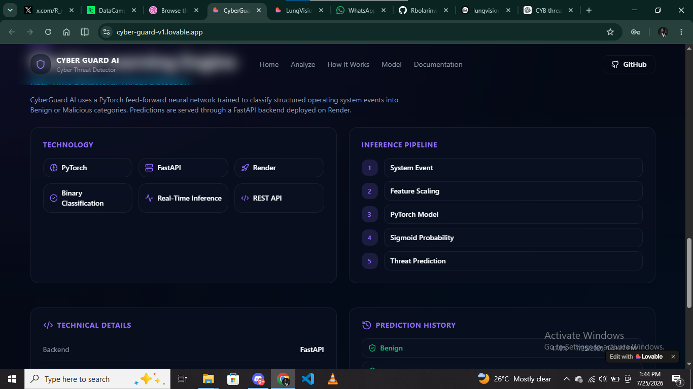

# 🛡️ Cyber Threat Detector

### Machine Learning-Based Linux System-Event Classification

A machine-learning project that uses a PyTorch neural network to classify structured Linux system-event records as **Benign** or **Malicious**.

Built with **Python, PyTorch, Scikit-learn, FastAPI, Render, and React**.

<p align="center">
  <a href="https://cyber-guard-v1.lovable.app/">🌐 Live Demo</a> •
  <a href="https://cyber-threat-detector-jafo.onrender.com/docs">📖 API Documentation</a> •
  <a href="https://github.com/Rbolarinwa-DS/cyber-threat-detector">💻 GitHub Repository</a>
</p>

---

# 📸 Application Preview

## 🤖 System-Event Analysis Interface

<p align="center">
  
</p>

## 📊 Classification Results

<p align="center">
  
</p>

---

# 📖 Overview

**Cyber Threat Detector** is an end-to-end Machine Learning application focused on classifying structured Linux system-event records into two categories: **Benign** and **Malicious**.

The project explores how machine learning can be applied to Linux system-level activity by learning patterns from selected event attributes.

The classification model uses four structured input features:

- User ID
- Mount Namespace
- Arguments Count
- Operation Return Value

A feed-forward neural network developed with PyTorch processes these features and produces a classification prediction alongside a probability score.

The project demonstrates the Machine Learning Engineering lifecycle, covering data preprocessing, neural network development, model inference, API development, and cloud deployment.

---

# 🚀 Key Features

- 🧠 PyTorch Feed-Forward Neural Network
- 🐧 Linux System-Event Classification
- 🔍 Benign and Malicious Event Classification
- 📊 Prediction Probability Scores
- 🎯 Classification Decision Threshold
- ⚡ Feature Standardization with Scikit-learn
- 🚀 FastAPI REST API
- ☁️ Render Backend Deployment
- 💻 Interactive Web Interface
- 📖 API Documentation with Swagger UI
- 📱 Responsive Frontend

---

# 🎯 Problem Focus

Linux operating systems generate structured system-level activity records containing information about users, namespaces, arguments, and operation results.

Examining these records individually can make it difficult to distinguish ordinary system activity from potentially malicious activity.

Cyber Threat Detector explores the application of supervised machine learning to this classification problem.

Rather than claiming to detect every category of cyberattack, the project focuses on a defined task:

**Using selected Linux system-event attributes to classify individual event records as benign or potentially malicious.**

This provides a practical demonstration of how a trained neural network can be incorporated into a system-event classification workflow.

---

# 📚 Dataset and Input Features

### Dataset

**BETH Cybersecurity Dataset**

The project uses structured operating system event data containing records associated with benign and malicious activity.

The model uses four selected features:

| Feature | Description |
|---|---|
| `userId` | User identifier associated with the event |
| `mountNamespace` | Mount namespace identifier |
| `argsNum` | Number of arguments associated with the operation |
| `returnValue` | Return value of the operation |

### Preprocessing

The selected numerical features are standardized using Scikit-learn's `StandardScaler`.

The fitted scaler is saved and reused during inference to ensure incoming records undergo the same feature transformation applied during model development.

---

# 🧠 Model Architecture

The classification model is a feed-forward neural network implemented using **PyTorch**.

### Architecture

| Layer | Configuration |
|---|---|
| Input Layer | 4 features |
| Hidden Layer 1 | 64 neurons + ReLU |
| Dropout | 0.3 |
| Hidden Layer 2 | 32 neurons + ReLU |
| Dropout | 0.3 |
| Output Layer | 1 neuron |

The model produces a logit that is converted into a probability using the sigmoid activation function.

A classification threshold of **0.5** is applied:

- Probability ≥ 0.5: Malicious
- Probability < 0.5: Benign

---

# 📈 Model Performance

| Metric | Score |
|---|---:|
| Accuracy | **68.00%** |
| Precision | **27.78%** |
| Recall | **31.25%** |
| F1 Score | **29.41%** |
| Architecture | Feed-Forward Neural Network |
| Framework | PyTorch |

These are the reported evaluation results for the current model.

The results also highlight opportunities for improvement in feature selection, model performance, and classification reliability.

---

# 🛡️ Prediction Output

The model returns one of two classification labels:

- **Benign**
- **Malicious**

Alongside the predicted class, the API returns a probability score representing the model's output for the malicious class.

Example response:

```json
{
  "prediction": "Malicious",
  "probability": 0.5137
}
```

The probability is a model output and should not automatically be interpreted as a calibrated measure of real-world threat confidence.

---

# 🏗️ Technology Stack

### Machine Learning and Data Processing

- Python
- PyTorch
- Scikit-learn
- NumPy
- Pandas
- Joblib

### Backend

- FastAPI
- Uvicorn
- Pydantic

### Frontend

- React
- TypeScript
- Tailwind CSS
- Lovable

### Deployment

- Render

---

# 📂 Project Structure

```text
Cyber-Threat-Detector/

├── app/
│   ├── main.py
│   └── model.py
│
├── models/
│   ├── best_model.pth
│   └── scaler.pkl
│
├── images/
│
├── requirements.txt
├── runtime.txt
├── README.md
└── LICENSE
```

---

# 📡 API Documentation

The trained model is exposed through a FastAPI REST API.

### Health Check

```http
GET /
```

Returns the API health status.

### Classification Endpoint

```http
POST /predict
```

Example request:

```json
{
  "userId": 1,
  "mountNamespace": 2,
  "argsNum": 3,
  "returnValue": 0
}
```

Example response:

```json
{
  "prediction": "Malicious",
  "probability": 0.5137
}
```

### API Documentation

Explore the interactive API documentation:

[Open Swagger UI](https://cyber-threat-detector-jafo.onrender.com/docs)

---

# ⚙️ Running Locally

### 1. Clone the repository

```bash
git clone https://github.com/Rbolarinwa-DS/cyber-threat-detector.git
```

### 2. Navigate into the project directory

```bash
cd cyber-threat-detector
```

### 3. Install dependencies

```bash
pip install -r requirements.txt
```

### 4. Start the API

```bash
python -m uvicorn app.main:app --reload
```

### 5. Open the API documentation

```text
http://127.0.0.1:8000/docs
```

---

# ⚠️ Current Limitations

Cyber Threat Detector is a proof-of-concept focused on a specific Linux system-event classification task.

Current limitations include:

- Classification is based on four selected input features.
- The model is limited to the patterns represented in its training data.
- The model does not independently establish whether a complete system or machine has been compromised.
- It does not perform intrusion prevention, automated incident response, or malware removal.
- The current implementation does not establish continuous system monitoring.
- Further feature engineering and model evaluation are needed to improve classification performance.

The project is intended to demonstrate practical Machine Learning Engineering and model-serving concepts rather than serve as a standalone production security solution.

---

# 🛣️ Development Roadmap

### Version 1.0 — Current Implementation

- [x] Dataset-based model development
- [x] PyTorch neural-network classifier
- [x] Feature standardization
- [x] FastAPI inference backend
- [x] Cloud backend deployment
- [x] Web-based frontend integration
- [x] Interactive API documentation

### Future Improvements

- [ ] Expanded Linux system-event feature engineering
- [ ] Further model evaluation and optimization
- [ ] Model explainability
- [ ] Docker containerization
- [ ] CI/CD integration
- [ ] Prediction history
- [ ] Model monitoring and evaluation dashboard
- [ ] Expanded system-event classification capabilities

---

# 📜 Disclaimer

Cyber Threat Detector is developed for educational, research, and demonstration purposes.

Its predictions are based on a machine-learning model trained on a particular dataset and a limited set of input features. They should not be treated as definitive evidence of malicious activity or used as a substitute for professional cybersecurity monitoring and investigation.

---

# ⭐ Support

If you find this project useful, consider giving the repository a **Star ⭐**.

---

# 👨‍💻 Author

**Rahman-Bolarinwa**

Machine Learning Engineer • Data Scientist

Building practical AI and Machine Learning solutions from research to deployment.

[GitHub](https://github.com/Rbolarinwa-DS)